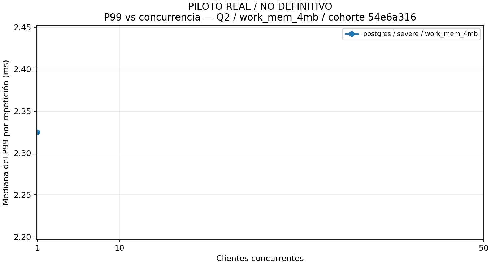
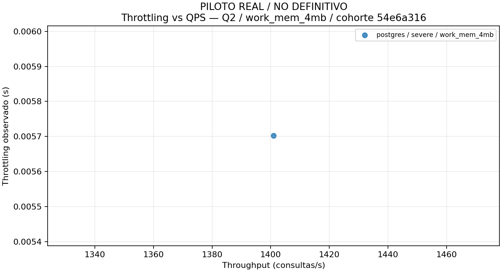
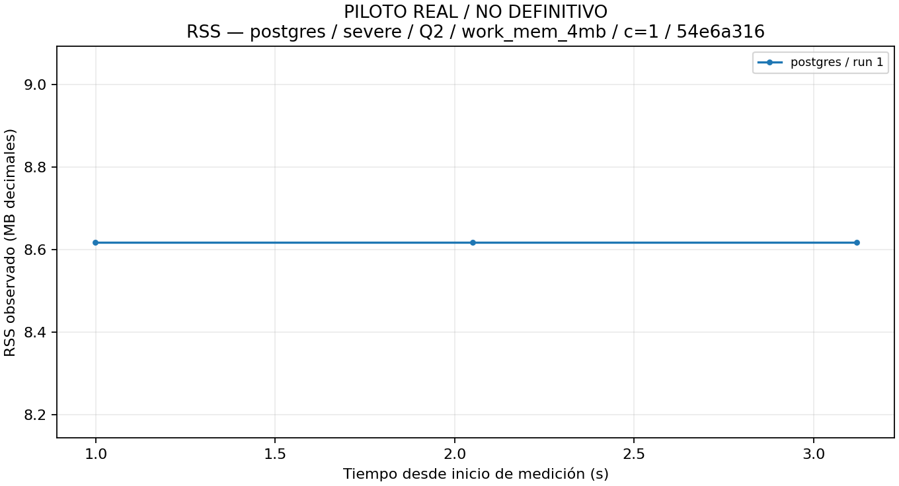

# MongoDB frente a PostgreSQL JSONB bajo contención de CPU y memoria

Universidad Politécnica de Chiapas
Bases de Datos en la Nube — Ingeniería en Tecnologías de la Información e Innovación Digital

**PILOTO REAL — NO RESULTADOS ACADÉMICOS DEFINITIVOS**

Estudiante: [Por completar]
Grupo: [Por completar]
Docente: [Por completar]
Fecha: 2026-11-01
Estado: DIAGNOSTIC_PARTIAL

Índice:
1. Especificaciones del host y entorno Docker
2. Método de medición y baseline
3. Resultados consolidados
4. Análisis gráfico
5. Planes de ejecución
6. Interpretación de los resultados
7. Recomendaciones técnicas

## 1 — Especificaciones del host y entorno Docker

Plataforma objetivo declarada por el usuario: Kubuntu Linux nativo x86_64, Ryzen 7 5700X, 32 GB RAM. La versión exacta de Kubuntu no se presume. Los valores observados abajo provienen de manifiestos/evidencias, no del equipo que genera el reporte.

| Cohorte | Dato | Valor | Procedencia |
| --- | --- | --- | --- |
| 54e6a3161f4642a0 | Sistema operativo registrado | {'ID': 'debian', 'PRETTY_NAME': 'Debian GNU/Linux 13 (trixie)', 'VERSION_ID': '13'} | manifiesto de ejecución |
| 54e6a3161f4642a0 | Kernel | 6.18.57 | manifiesto de ejecución |
| 54e6a3161f4642a0 | Procesador | Intel(R) Xeon(R) Platinum 8370C CPU @ 2.80GHz | manifiesto de ejecución |
| 54e6a3161f4642a0 | RAM registrada (KiB) | 10207480 | manifiesto de ejecución |
| 54e6a3161f4642a0 | Arquitectura | x86_64 | manifiesto de ejecución |
| 54e6a3161f4642a0 | cgroups v2 visibles | Sí | manifiesto de ejecución |
| 54e6a3161f4642a0 | Boot ID | 7ba12ce3-0188-4a91-945f-862001236350 | manifiesto de ejecución |
| 54e6a3161f4642a0 | Versión Kubuntu | No verificada como Kubuntu | no sustituir versión Ubuntu por prueba del sabor Kubuntu |
| 54e6a3161f4642a0 | Docker Engine/Compose | No registrados en este manifiesto | captura independiente opcional, no inferidos desde imagen |
| 54e6a3161f4642a0 | postgres | {'image': 'postgres:18.6-bookworm@sha256:5c4783a8cc3f0074912164f94dfa1be4e043438f0f707cf968d7af9a0d31a2c8', 'image_id': 'sha256:dc3f873bf9f13956c6821197edd8e0224b93086f3312830faf5d76699d43710b', 'server_version': '18.6 (Debian 18.6-1.pgdg12+2)'} | versión/imagen observadas por runner |
| 54e6a3161f4642a0 | Prometheus observado | {'branch': 'HEAD', 'buildDate': '20261021-13:31:17', 'buildUser': 'root@03bc6b0f3ef7', 'goVersion': 'go1.27.3', 'revision': 'bae3eced0a5369e050e83ea73bc381d7c4b1a719', 'version': '3.15.1'} | evidencia de telemetría |
| 54e6a3161f4642a0 | Exportadores observados | {'cadvisor_version_info': {'__name__': 'cadvisor_version_info', 'cadvisorRevision': '5bf5d43', 'cadvisorVersion': 'v0.60.6', 'instance': '172.20.0.2:8080', 'job': 'cadvisor', 'kernelVersion': '6.18.57', 'osVersion': 'Alpine Linux v3.23'}, 'node_exporter_build_info': {'__name__': 'node_exporter_build_info', 'branch': 'HEAD', 'goarch': 'amd64', 'goos': 'linux', 'goversion': 'go1.26.5', 'instance': '172.20.0.3:9100', 'job': 'node', 'revision': '6044da783597cc3b57aef7580ddcdcff58a4ee99', 'tags': 'unknown', 'version': '1.12.1'}} | evidencia de telemetría |

| Perfil | CPU | Memoria configurada | Estado |
| --- | --- | --- | --- |
| PROFILE_A_BASELINE | 4 | 4096 MiB Docker | Solicitado; ver snapshots efectivos por repetición |
| PROFILE_B_MEDIUM | 2 | 2048 MiB Docker | Solicitado; ver snapshots efectivos por repetición |
| PROFILE_C_SEVERE | 1 | 1024 MiB Docker | Solicitado; ver snapshots efectivos por repetición |

## 2 — Método de medición y baseline

Objetivo: comparar agregaciones JSON equivalentes bajo contención controlada. Fuentes: playbook.pdf pp.1–4 §§1–8 y playbook_sesion.pdf pp.3–11. M1: cambios en P95/P99 al limitar CPU/memoria. M2: gestión de buffers antes de spill/OOM. M3: huella CPU/memoria por 1000 documentos; operacionalización pendiente, no se calcula con throttling como CPU consumida.

Contrato: 500000 órdenes JSON anidadas, media objetivo de tres ítems; Q1 desanida, filtra price>50 y agrupa qty×price por país/categoría; Q2 completed y timestamp>=2026-01-01 UTC, total descendente, Top-1000. Alias de pagos/tipos/índice temporal y adaptación swap siguen documentados como provisionales; no se declaran aprobados por este generador.

Protocolo original: limpieza de caché, warmup 60s, medición 300s, cooldown 60s; concurrencias 1/10/50; tres repeticiones. Se registran variantes Q2 por manifiesto, sin modificar el CSV. La constancia manual de caché es declaración del operador, no prueba automática del estado del kernel.

Runner: sesiones independientes, consumo completo de resultados y reloj monotónico. QPS=éxitos íntegramente dentro de ventana/duración fija; cruces de borde, errores, warmup/cooldown excluidos. Percentiles de cada repetición: Hyndman–Fan R7 exacto en disco. Las medias/medianas de esos P99 NO son P99 combinado de latencias individuales.

Telemetría: Prometheus/cAdvisor/Node Exporter con scrape 1s; throttling=last−first de muestras interiores (subintervalo observado, bordes omitidos), RSS máximo observado/1000000. Spill y OOM requieren evidencia específica. Un máximo RSS no permite fabricar curva temporal. Instrumentación y análisis añaden carga al host: este análisis no consulta motores ni adquiere locks del runner; ejecutar fuera de ventanas sensibles/en otro equipo si se quiere evitar interferencia CPU/IO.

Tiempo disponible declarado: 13h. Base 108×420s=12h36, deja SOLO 24min para toda preparación, flush, drenaje, fallos y reporte. Extendida 162×420s=18h54, excede el presupuesto aun sin sobrecostes y continúa pendiente de aprobación. No se reduce el protocolo para ajustarlo.

Configuración observada c104690dadc7455ea0410c07d0f9ad37: dataset {'configuration': {'count': 100, 'distribution': 'academic-provisional-v1', 'end': '2026-10-01T00:00:00Z', 'payment_layout': 'totals-and-alias', 'prng': 'sha256-counter-u32-rejection-v1', 'seed': 42, 'start': '2025-07-01T00:00:00Z', 'uuid': 'uuid5-seed-entity-index-v1'}, 'count': 100, 'sha256': '4654466a1e399e3ed332a5d044b1b8478ef6dfe55509f8dbf1249fca66db0587'}; protocolo {'cache': 'skip', 'cooldown': Decimal('1.0'), 'measurement': Decimal('4.0'), 'mode': 'pilot', 'timeout_ms': 3000, 'warmup': Decimal('1.0')}; versión runner 1.1.0-provisional.

## 3 — Resultados consolidados

Resúmenes descriptivos exclusivamente de repeticiones válidas dentro de cada cohorte/motor/perfil/consulta/variante/concurrencia. Media, mediana, mínimo y máximo son de KPIs por repetición; no se mezclan muestras crudas ni modalidades. En pilotos, “válida” significa solo diagnóstico técnico, nunca elegibilidad académica. Presentación con hasta siete cifras significativas; statistics.json conserva los decimales de cálculo.

| Cohorte | Esperadas | Terminadas | Válidas | Fallidas | Pendientes | Avance % | ETA aproximada s |
| --- | --- | --- | --- | --- | --- | --- | --- |
| 54e6a3161f4642a0 | 1 | 1 | 1 | 0 | 0 | 100 | 0e-9 |

| Cohorte | Motor | Perfil | Q | Variante | Clientes | Válidas/3 | Spill confirmado | OOM confirmado | Estado |
| --- | --- | --- | --- | --- | --- | --- | --- | --- | --- |
| 54e6a3161f4642a0 | postgres | severe | Q2 | work_mem_4mb | 1 | 1/3 | 0 | 0 | incomplete/preliminary |

### throughput_qps (consultas/s) — entre repeticiones

| Cohorte / motor / perfil / consulta / variante / clientes | n | Media | Mediana | Mínimo | Máximo |
| --- | --- | --- | --- | --- | --- |
| 54e6a3161f4642a0 / postgres / severe / Q2 / work_mem_4mb / 1 | 1 | 1401 | 1401 | 1401 | 1401 |

### latency_p50_ms (ms) — entre repeticiones

| Cohorte / motor / perfil / consulta / variante / clientes | n | Media | Mediana | Mínimo | Máximo |
| --- | --- | --- | --- | --- | --- |
| 54e6a3161f4642a0 / postgres / severe / Q2 / work_mem_4mb / 1 | 1 | 0.405487 | 0.405487 | 0.405487 | 0.405487 |

### latency_p95_ms (ms) — entre repeticiones

| Cohorte / motor / perfil / consulta / variante / clientes | n | Media | Mediana | Mínimo | Máximo |
| --- | --- | --- | --- | --- | --- |
| 54e6a3161f4642a0 / postgres / severe / Q2 / work_mem_4mb / 1 | 1 | 1.047807 | 1.047807 | 1.047807 | 1.047807 |

### latency_p99_ms (ms) — entre repeticiones

| Cohorte / motor / perfil / consulta / variante / clientes | n | Media | Mediana | Mínimo | Máximo |
| --- | --- | --- | --- | --- | --- |
| 54e6a3161f4642a0 / postgres / severe / Q2 / work_mem_4mb / 1 | 1 | 2.324724 | 2.324724 | 2.324724 | 2.324724 |

### cpu_throttled_seconds (s observados) — entre repeticiones

| Cohorte / motor / perfil / consulta / variante / clientes | n | Media | Mediana | Mínimo | Máximo |
| --- | --- | --- | --- | --- | --- |
| 54e6a3161f4642a0 / postgres / severe / Q2 / work_mem_4mb / 1 | 1 | 0.005702 | 0.005702 | 0.005702 | 0.005702 |

### max_rss_mb (MB decimales) — entre repeticiones

| Cohorte / motor / perfil / consulta / variante / clientes | n | Media | Mediana | Mínimo | Máximo |
| --- | --- | --- | --- | --- | --- |
| 54e6a3161f4642a0 / postgres / severe / Q2 / work_mem_4mb / 1 | 1 | 8.617984 | 8.617984 | 8.617984 | 8.617984 |

| Cohorte | Q/perfil/clientes | Pareja de modalidades | Comparación | Razón |
| --- | --- | --- | --- | --- |
| Sin observaciones | — | — | — | — |

## 4 — Análisis gráfico

P99 frente a concurrencia usa mediana del P99 de repeticiones válidas. Throttling/QPS usa puntos por repetición. RSS usa muestras temporales originales verificadas, con tiempo relativo al inicio y huecos explícitos. Cohortes/modalidades se separan; las comparaciones entre motores requieren pareja equivalente y tres repeticiones por cada motor.

P99 postgres/Q2/work_mem_4mb; mediana de P99 de repeticiones válidas, no P99 combinado. Huecos no conectados.

Throttling frente a QPS postgres/Q2/work_mem_4mb: un punto por repetición válida; sin inferencia causal.

Serie RSS real de postgres / severe / Q2 / work_mem_4mb / c=1 / 54e6a316. Picos entre muestras no observables; gaps mayores a 2.5s no conectados.

## 5 — Planes de ejecución

Plan diagnóstico /workspace/docs/evidence/phase3/phase3test_cee003d881c443b28817209855663401_after_text_proposal_plan.json — postgres/Q2/work_mem_4mb; dataset registrado=10; hash vinculado=No disponible. Diagnostic execution; not evidence of spill of a previous timed query or benchmark latency

| Ruta nodo | Operaciones/índices/sort/grupos/filas/buffers/temporales (campos disponibles) |
| --- | --- |
| 0.Plan | {'Node Type': 'Limit', 'Actual Rows': Decimal('5.00'), 'Actual Loops': 1, 'Temp Read Blocks': 0, 'Temp Written Blocks': 0, 'Shared Read Blocks': 0, 'Shared Hit Blocks': 5} |
| 0.Plan.Plans.0 | {'Node Type': 'Sort', 'Actual Rows': Decimal('5.00'), 'Actual Loops': 1, 'Sort Method': 'quicksort', 'Sort Space Used': 25, 'Sort Space Type': 'Memory', 'Temp Read Blocks': 0, 'Temp Written Blocks': 0, 'Shared Read Blocks': 0, 'Shared Hit Blocks': 5} |
| 0.Plan.Plans.0.Plans.0 | {'Node Type': 'Seq Scan', 'Relation Name': 'orders', 'Actual Rows': Decimal('5.00'), 'Actual Loops': 1, 'Temp Read Blocks': 0, 'Temp Written Blocks': 0, 'Shared Read Blocks': 0, 'Shared Hit Blocks': 2} |

Plan diagnóstico /workspace/docs/evidence/phase3/phase3test_dbce03e4cf8841519ce6132f50f9ef60_Q1_default_plan.json — postgres/Q1/default; dataset registrado=10; hash vinculado=No disponible. Diagnostic execution; not evidence of spill of a previous timed query or benchmark latency

| Ruta nodo | Operaciones/índices/sort/grupos/filas/buffers/temporales (campos disponibles) |
| --- | --- |
| 0.Plan | {'Node Type': 'Aggregate', 'Actual Rows': Decimal('3.00'), 'Actual Loops': 1, 'Peak Memory Usage': 161, 'HashAgg Batches': 1, 'Temp Read Blocks': 0, 'Temp Written Blocks': 0, 'Shared Read Blocks': 0, 'Shared Hit Blocks': 2} |
| 0.Plan.Plans.0 | {'Node Type': 'Nested Loop', 'Actual Rows': Decimal('5.00'), 'Actual Loops': 1, 'Temp Read Blocks': 0, 'Temp Written Blocks': 0, 'Shared Read Blocks': 0, 'Shared Hit Blocks': 2} |
| 0.Plan.Plans.0.Plans.0 | {'Node Type': 'Seq Scan', 'Relation Name': 'orders', 'Actual Rows': Decimal('10.00'), 'Actual Loops': 1, 'Temp Read Blocks': 0, 'Temp Written Blocks': 0, 'Shared Read Blocks': 0, 'Shared Hit Blocks': 2} |
| 0.Plan.Plans.0.Plans.1 | {'Node Type': 'Function Scan', 'Actual Rows': Decimal('0.50'), 'Actual Loops': 10, 'Temp Read Blocks': 0, 'Temp Written Blocks': 0, 'Shared Read Blocks': 0, 'Shared Hit Blocks': 0} |

Plan diagnóstico /workspace/docs/evidence/phase3/phase3test_dbce03e4cf8841519ce6132f50f9ef60_Q2_work_mem_4mb_plan.json — postgres/Q2/work_mem_4mb; dataset registrado=10; hash vinculado=No disponible. Diagnostic execution; not evidence of spill of a previous timed query or benchmark latency

| Ruta nodo | Operaciones/índices/sort/grupos/filas/buffers/temporales (campos disponibles) |
| --- | --- |
| 0.Plan | {'Node Type': 'Limit', 'Actual Rows': Decimal('5.00'), 'Actual Loops': 1, 'Temp Read Blocks': 0, 'Temp Written Blocks': 0, 'Shared Read Blocks': 0, 'Shared Hit Blocks': 5} |
| 0.Plan.Plans.0 | {'Node Type': 'Sort', 'Actual Rows': Decimal('5.00'), 'Actual Loops': 1, 'Sort Method': 'quicksort', 'Sort Space Used': 25, 'Sort Space Type': 'Memory', 'Temp Read Blocks': 0, 'Temp Written Blocks': 0, 'Shared Read Blocks': 0, 'Shared Hit Blocks': 5} |
| 0.Plan.Plans.0.Plans.0 | {'Node Type': 'Seq Scan', 'Relation Name': 'orders', 'Actual Rows': Decimal('5.00'), 'Actual Loops': 1, 'Temp Read Blocks': 0, 'Temp Written Blocks': 0, 'Shared Read Blocks': 0, 'Shared Hit Blocks': 2} |

Plan diagnóstico /workspace/docs/evidence/phase3/phase3test_dbce03e4cf8841519ce6132f50f9ef60_Q2_work_mem_64mb_plan.json — postgres/Q2/work_mem_64mb; dataset registrado=10; hash vinculado=No disponible. Diagnostic execution; not evidence of spill of a previous timed query or benchmark latency

| Ruta nodo | Operaciones/índices/sort/grupos/filas/buffers/temporales (campos disponibles) |
| --- | --- |
| 0.Plan | {'Node Type': 'Limit', 'Actual Rows': Decimal('5.00'), 'Actual Loops': 1, 'Temp Read Blocks': 0, 'Temp Written Blocks': 0, 'Shared Read Blocks': 0, 'Shared Hit Blocks': 5} |
| 0.Plan.Plans.0 | {'Node Type': 'Sort', 'Actual Rows': Decimal('5.00'), 'Actual Loops': 1, 'Sort Method': 'quicksort', 'Sort Space Used': 25, 'Sort Space Type': 'Memory', 'Temp Read Blocks': 0, 'Temp Written Blocks': 0, 'Shared Read Blocks': 0, 'Shared Hit Blocks': 5} |
| 0.Plan.Plans.0.Plans.0 | {'Node Type': 'Seq Scan', 'Relation Name': 'orders', 'Actual Rows': Decimal('5.00'), 'Actual Loops': 1, 'Temp Read Blocks': 0, 'Temp Written Blocks': 0, 'Shared Read Blocks': 0, 'Shared Hit Blocks': 2} |

Campos ausentes permanecen desconocidos. Actual Rows/Actual Loops se muestran separadamente, no se suman como documentos procesados M3. EXPLAIN ANALYZE y executionStats ejecutan una consulta diagnóstica; su tiempo no sustituye latencia del runner ni acredita spill de otra ejecución. Planes sin dataset/variante vinculados se presentan como auxiliares, no equivalentes al escenario medido.

## 6 — Interpretación de los resultados

### Conclusiones e interpretación

M3 NO CALCULABLE: faltan metodología aprobada para documentos procesados y consumo de CPU usado/normalización de memoria. El conteo del archivo fuente no equivale a documentos procesados por cada consulta; throttling no es CPU usada.

PENDIENTE: no hay comparaciones entre motores con tres repeticiones válidas equivalentes. Los resultados disponibles solo describen las filas observadas; no permiten declarar un motor superior ni efectos causales de recursos/concurrencia.

Limitaciones: repeticiones incompletas indicadas, muestreo 1s no captura todos los picos, bordes de throttling omitidos, cambios de host/código segregados, instrumentación/runner compiten por recursos del host y constancias de caché no prueban buffers internos. Una asociación throughput/throttling o incremento de percentiles no identifica por sí sola una causa. La extensión 162 no se aprueba por poder generar este documento.

Desviación registrada: cache flush skipped, not protocol-equivalent

Desviación registrada: index conformity pending; pilot only

Desviación registrada: pilot: ancestors/other engine isolation not fully validated

Desviación registrada: small dataset, not definitive

## 7 — Recomendaciones técnicas

Recomendaciones generales (no derivadas de un ganador experimental): verificar límites reales/ancestros y salud; dimensionar memoria por operación y número de clientes; vigilar throttling, RSS, temporales y OOM; conservar datos originales/versiones; realizar piloto antes de la matriz; no asumir equivalencia de cachés/buffers internos ni de permisos de observabilidad. Son criterios operativos, no conclusiones comparativas de este estudio.

Recomendaciones específicas: PENDIENTES de comparaciones válidas. No se recomienda MongoDB o PostgreSQL JSONB como superior en rendimiento/estabilidad sin evidencia equivalente.

## Anexos

Estado solicitado/efectivo: DIAGNOSTIC_PARTIAL. Cobertura se calcula por cohorte, no sumando datasets o versiones incompatibles.

Validación para informe final: ['Se requiere auditoría completa de hashes para informe final', 'Pilotos: excluidos del experimento académico definitivo', 'La selección no constituye una matriz base/extendida completa', 'Hay escenarios sin tres repeticiones válidas', 'Faltan planes diagnósticos vinculados explícitamente al hash del dataset/consulta/variante']

Integridad: selected; selected verifica hashes de JSON/CSV usados y existencia del resto; all verifica también journals binarios, sin copiarlos masivamente al reporte. Un commit nuevo posterior al corte se verá en la siguiente generación.

| Experimento | Escenario | Estado | Causa de exclusión |
| --- | --- | --- | --- |
| Sin observaciones | — | — | — |

Intentos no confirmados (pueden estar activos o interrumpidos; no se infiere actividad por existencia del lock): []

Fuentes preservadas por hash en snapshot/index.json; request.json/statistics.json/coverage.json/analysis-manifest.json permiten auditar entradas y cálculos. No contienen credenciales ni copias del dataset.

